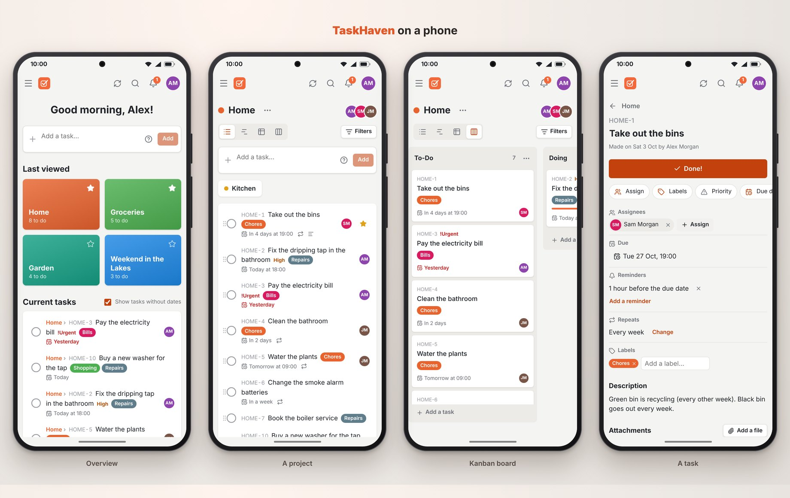
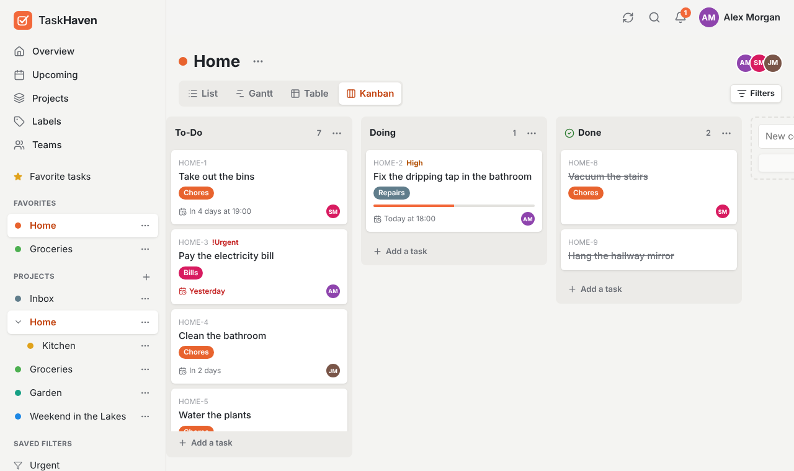

<p align="center"></p>

# TaskHaven

To-do lists and projects for Android, kept on your own [Vikunja](https://vikunja.io) server: one at
home (a NAS, a Raspberry Pi, a home server), or one on the internet at an https address. Each person
on the server sees only their own projects, and those shared with them. Share a project with your
partner, and just the two of you see it.

TaskHaven is an independent app that works with Vikunja servers. It isn't made by, or connected
with, the Vikunja project.

<p align="center"></p>
<p align="center"></p>

## What it does

- **Projects** with sub-projects, colours, an identifier (tasks are numbered `HOME-12`), favourites,
  archiving and duplicating.
- **Four views of a project:** a list (drag to reorder), a table (pick the columns, sort by any), a
  **Kanban** board (drag cards between columns; a "done" column ticks them off; column limits) and a
  **Gantt** chart (drag bars to move them, or their end to make them longer).
- **Tasks** with assignees, labels, priority (up to *DO NOW*), due, start and end dates, reminders,
  repeating (every day, every 2 weeks, monthly, "3 days from when it's done" …), progress, colour,
  a description with formatting and checklists, attachments, related tasks (subtasks, blocking,
  duplicates …) and comments.
- **Quick add:** type `Take out the bins every tuesday at 7pm *chores @sam !3` and the date, repeat,
  label, person and priority are taken out of the title.
- **Sharing:** with someone on the server by their exact username, with a **team** (everyone in it,
  now or later), or by a link that opens the project in the server's web pages. Each gets a right:
  *can see*, *can edit* or *admin*. Nobody can browse the server's users, and nobody sees anyone
  else's email. The server tells people when they're assigned a task, or someone comments on it.
- **Overview** (greeting, current tasks, last viewed projects), **Upcoming** (by day, overdue first),
  **search** (words, or a task's number), **saved filters** (`done = false && dueDate < now+7d`),
  **labels**, light and **dark** theme.
- **Reminders and due dates** come as phone notifications, even when the app is closed.
- **Without the server** (away from home, say) the app shows what it fetched last; changes need the
  server. It checks the server every 45 seconds while open, and whenever you come back to it.
- A **demo** (a made-up family, on the phone only), from "Try the demo" on the first screen.

Everything is on the server, so it's also there in Vikunja's own web pages, and in its other apps.

## How it works

The app talks to the server's API (`/api/v1`, Vikunja 0.24 and later; checked against 2.7.1).

- **Signing in** is by username (or email) and password, with a two-step code if the account has
  one. The app then gets its own session from the server (Vikunja's OAuth code flow, client
  `taskhaven`), which renews itself; on an older server without it, it uses the login's long token.
  The session is kept on the phone, never the password.
- **Who sees what** is the server's work: TaskHaven shows what the server gives it.
- On the phone, requests go through Android rather than the web view (`src/data/http.ts`), so a
  server at home can be plain `http://` and needs no CORS set up for the app. The app itself only
  allows `http://` for addresses on the home network (`192.168.…`, `10.…`, `….local`, Tailscale's
  `100.64–127.…`); anything else must be `https://`.
- What was fetched is kept on the phone (for opening without the server), per account.

`src/data/memory.ts` behaves like a Vikunja server in memory, for the demo and the tests.

## Running a server

Follow [Vikunja's install guide](https://vikunja.io/docs/installing/). With Docker, its SQLite
example comes down to this `compose.yaml` (make the `files` and `db` folders first and
`chown 1000` them; SQLite is fine for a family, the guide has MySQL and PostgreSQL for more):

```yaml
services:
  vikunja:
    image: vikunja/vikunja
    environment:
      VIKUNJA_SERVICE_SECRET: <a long random secret>
      VIKUNJA_SERVICE_PUBLICURL: http://192.168.1.20:3456/
      VIKUNJA_DATABASE_PATH: /db/vikunja.db
    ports:
      - 3456:3456
    volumes:
      - ./files:/app/vikunja/files
      - ./db:/db
    restart: unless-stopped
```

Then in TaskHaven: **I have a server**, type `192.168.1.20:3456`, and make the accounts (or have
everyone make their own). Worth knowing:

- **Away from home** the phone needs to reach the server: a VPN such as Tailscale (use the
  server's Tailscale address), or a domain with https in front of it (a reverse proxy like Caddy,
  or a tunnel). `VIKUNJA_SERVICE_PUBLICURL` should be the address people use; share links use it.
- **New accounts**: once everyone has one, turn registration off
  (`VIKUNJA_SERVICE_ENABLEREGISTRATION: "false"`); the app then only offers signing in.
- **Email** (`VIKUNJA_MAILER_*`): without it, "forgot your password" and deleting an account
  (which the server confirms by email) can't work, and whoever runs the server does them instead.
- Back up the `db` and `files` folders.

Vikunja is a separate project (AGPL-3.0); TaskHaven uses
only its public API and contains none of its code.
